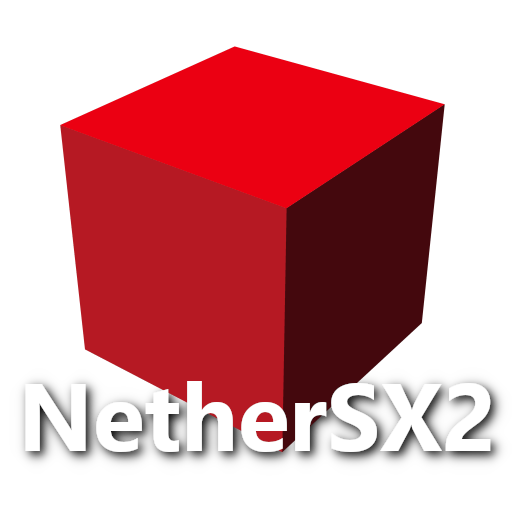

<div align=center>



</div>
<h1 align=center>NetherSX2 · Switch Port</h1>

A wrapper/port of NetherSX2 to the Nintendo Switch.
It loads the original Android emulator core `libemucore.so`, 
patches it, and runs it inside a minimal Android-like
environment natively.

Everything ships as a **single `NetherSX2.nro`**: it bundles both emulator cores
(Patched `4248` + Classic `3668`), both renderer backends (OpenGL + Vulkan/NVK)
and each build's data files, and extracts the ones you pick to the SD card at
launch. An SDL cover-art launcher chooses the game, the renderer, and per-game
settings, then chainloads the emulator.

The launcher supports multiple library folders across SD, USB mass storage
(FAT32, exFAT, NTFS), and SMB shares.

**L + R + Plus** to open the quick menu for save states, controller rebinding,
selectable per-game PNACH cheat codes, RetroAchievements progress,
frame-limiter control, reset, and exit.
The cheat browser reads `/switch/nethersx2/cheats/<CRC>.pnach`, recognizes PNACH
`[sections]` and legacy `// code name` blocks.

No emulator core, BIOS, or game assets are included in this repository.

### How to install

1. Copy `NetherSX2.nro` into `/switch/` on your SD card.
2. Put your own PS2 BIOS dump into `/switch/nethersx2/bios/`.

The launcher creates the rest of the folder tree on first run:

```
/switch/NetherSX2.nro
/switch/nethersx2/
  .emu/         <- extracted when selected
  bios/         <- your PS2 BIOS dump           (you supply)
  resources/    <- shaders / GameIndex / fonts  (auto-extracted per core)
  covers/       <- cover art (<game-key>.png)
  gamecfg/      <- per-game launcher settings
  lsfg/         <- optional user-supplied Lossless.dll
  forwarders/   <- HOME shortcut launch records
  hidden.ini    <- hidden library entries
  launcher.ini  <- the launcher's saved config
```

### Notes

This will not run in applet/album mode — it needs the full memory of a game
override. Launch it by holding **R** while opening an installed title, or use a
forwarder.

A PS2 BIOS dump is required and must come from your own console; the launcher
warns at startup when `bios/` is empty.

Casual RetroAchievements are available from **Settings > RetroAchievements**.
Sign in once in the launcher, then enable achievements before starting a game.
Successful sign-in stores the returned account token in `launcher.ini`.
Achievement progress and descriptions can be viewed during play from
**L + R + Plus > Achievements**.

LSFG 2x Frame Generation is available for the Vulkan renderer in
**Settings > Frame Generation**.
You must provide your own `Lossless.dll` at `/switch/nethersx2/lsfg/Lossless.dll`.
LSFG must be enabled before launching a game so the Vulkan session can be
prepared. Frame Generation starts **Off** in every game and must be enabled
manually from **L + R + Plus > Frame Generation**. Skip Duplicate Frames is
automatically enabled for prepared LSFG sessions so only unique game frames
are interpolated.

### Tegra X1 performance tuning

The Switch runs on an NVIDIA Tegra X1 (4x Cortex-A57 @ 1020 MHz, Maxwell GM20B,
4 GB of LPDDR4 shared between the CPU and the GPU at ~25.6 GB/s). PS2 emulation
here is limited by that shared memory link first and by the CPU second, so the
port ships a few X1-specific knobs (NEON memory primitives, thread affinity,
and optional DVFS clock control) described in
[TEGRA_X1_TUNING.md](TEGRA_X1_TUNING.md) — including the `Wrapper/CpuBoostMode`
and `Wrapper/ClockProfile` settings in `nethersx2.ini` and an on-device A/B
measurement protocol.

### How to build

Install the devkitPro Switch toolchain and portlibs:

```sh
pacman -S devkitA64 switch-tools libnx switch-sdl2 switch-sdl2_ttf \
          switch-sdl2_image switch-curl switch-mesa switch-libdrm_nouveau \
          switch-ntfs-3g
```

The Vulkan build needs a Mesa NVK driver archive set; pick one of:

* **nxvk** (public, GPL-2.0-or-later) — Mesa 26.2.2 NVK for Tegra X1,
  <https://github.com/PalindromicBreadLoaf/nxvk>:

  ```sh
  git clone -b switch https://github.com/PalindromicBreadLoaf/nxvk
  cd nxvk && make image && make && sudo make install   # needs docker/podman
  export MESA_FLAVOR=nxvk                              # link via nxvk.pc
  ```

* **vendored bundle** (default) — drop the NVK archives under `vulkan/include`
  and `vulkan/lib`. That bundle is not in this repository.

Extract the 4248 and 3668 APKs into sibling folders named
`NetherSX2-v2.2n-4248` and `NetherSX2-v2.2n-3668`, or set `CORES_DIR` to the
folder containing them. CMake, Ninja, and Git are required; the build downloads pinned
libsmb2 and libusbhsfs revisions.

```sh
./build_all.sh

# narrower bundles: one core, one renderer (also hides the matching menu entries)
CORES=4248 RENDERERS=VK MESA_FLAVOR=nxvk ./build_all.sh
```

### Continuous integration

`.github/workflows/nethersx2-build.yml` builds the OpenGL emulator core host and the
launcher (plus the forwarder stub) with devkitPro on every push and pull
request, and runs the host-side tests for the Tegra X1 memory primitives. Neither
the NVK driver bundle nor the Android cores are in this repository, so that
workflow builds and uploads the emulator/launcher binaries only.

`.github/workflows/release-vulkan.yml` is a manual workflow that publishes a
complete `NetherSX2.nro`: it builds nxvk, fetches the 4248 `libemucore.so` from
the public NetherSX2 APK, builds the Vulkan renderer with `MESA_FLAVOR=nxvk`
and creates a GitHub release. Because nxvk is GPL-2.0-or-later and linked
statically, the resulting binary is a combined work under the GPL — the release
notes say so.


### Credits

* The AetherSX2 / PCSX2 developers for the emulator.
* The NetherSX2 maintainers for the patched Android builds.
* fgsfds for the Switch so-loader groundwork reused here.
* TheOfficialFloW for the original Android so-loader lineage.
* Dantiicu for Switch Vulkan driver.
* Slluxx for IconGrabber.

### Support

If you enjoy my work and want to support me :

[](https://ko-fi.com/D1D1P2MOG)

### Legal

This project has no affiliation with the AetherSX2 or PCSX2 developers. No BIOS,
game images, or the emulator core are distributed here; you must supply your own
BIOS dump and legally-owned game images. We do not condone piracy.

Unless noted otherwise, the source in this repository is under the MIT License
(see LICENSE). The vendored LSFG-VK subset under `third_party/lsfg-vk` is
GPL-3.0-or-later.
